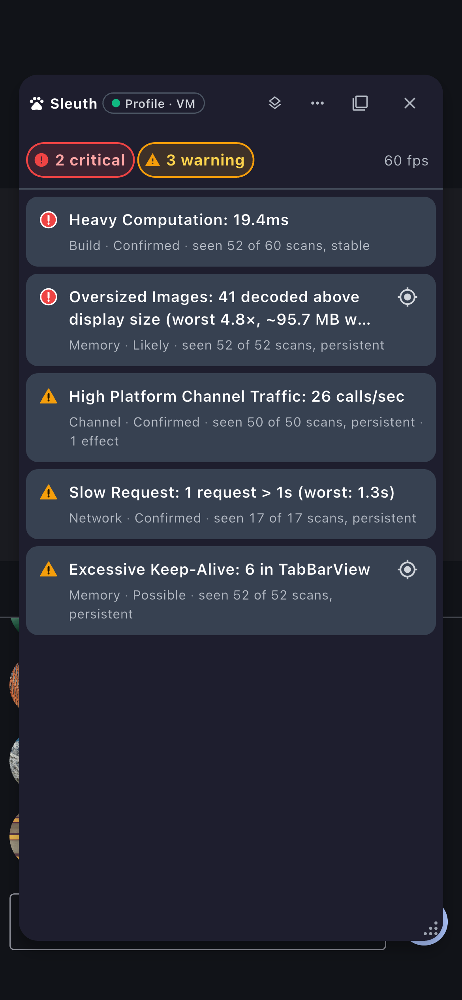
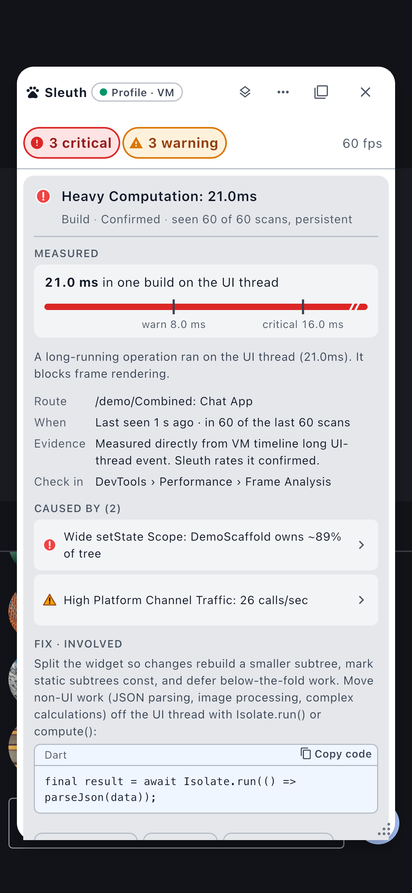

<p align="center">
  
</p>

# Sleuth

[](https://pub.dev/packages/sleuth)
[](https://flutter.dev)
[](https://opensource.org/licenses/MIT)
[]()
[]()

Sleuth is an in-app performance diagnostics overlay for Flutter. It shows jank, memory leaks, slow network requests, GPU pressure and widget anti-patterns inside your app, and every issue comes with a fix hint.

<p align="center">
  
  &nbsp;&nbsp;
  
</p>

## Why Sleuth

Where Sleuth helps more than DevTools:

- **Always on.** Sleuth runs inside the app, so there is no tool window or connection to set up, and it stays visible while you use the app.
- **Structural checks.** It flags problems DevTools does not: non-lazy lists, images decoded above display size, missing `RepaintBoundary`, intrinsic layout and retained stream subscriptions.
- **Explained issues.** Each card names the widget and its source line (`file.dart:42`), gives a fix hint, and says what evidence it is based on and how confident it is: confirmed, likely or possible.
- **Causes linked to effects.** 42 causal rules link a root cause to the issues it causes, so a card shows why an issue matters.
- **Fix verification and trends.** Capture a baseline, apply the fix and compare. Each card's meta line ("seen 19 of 20 scans, persistent") shows whether an issue is getting better or worse across scans.
- **AI help.** Ask the AI provider of your choice about any issue from its card, or let an assistant query the running app through the `sleuth_mcp` sidecar.

What DevTools still does better:

- **Heap snapshots and the object graph.** DevTools can browse every object in the heap and inspect retention paths. Sleuth watches heap trends and GC pressure, not single objects.
- **Full flame charts.** DevTools has zoomable per-frame timelines with the complete call tree. With `SleuthConfig(cpuAttribution: true)` Sleuth adds the top five functions by CPU time to a jank frame's verdict, at most once every 10 s; it is off by default because each request freezes the UI isolate for about 300 ms.

Use Sleuth to find a problem and its category inside the app, then DevTools to dig deeper.

## Quick start

```bash
flutter pub add sleuth
```

```dart
import 'package:sleuth/sleuth.dart';

void main() => runApp(Sleuth.track(child: MyApp()));
```

```bash
flutter run --profile --no-dds
```

Tap the trigger button to open the dashboard. The overlay appears in debug and profile mode. In release builds the compiler drops Sleuth's code, so an app wrapped in `Sleuth.track` is the same size as one without it. A `SleuthConfig` that your code builds stays in, and one with an AI adapter and a custom detector adds 64 KB. Sleuth requires Flutter 3.32 or later (Dart 3.8 or later). `event_loop_stall` needs Flutter 3.35 or later, where the VM reports timers that fire late; on older versions it stays silent. Profile mode gives accurate timing, and `--no-dds` lets Sleuth connect to the VM service, which its memory, CPU and time-share detectors need (see [Reaching full mode](#reaching-full-mode)).

## What Sleuth finds

Sleuth has 21 detectors:

- **Frames and rendering.** Frames that miss their deadline against the measured frame budget (minus start delay Sleuth itself caused), UI isolate stalls of 100 ms or more, raster-thread dominance, shader compilation, expensive render nodes such as `BackdropFilter`, and missing `RepaintBoundary`.
- **Build and paint.** The share of UI-thread time spent building and painting, wide `setState` scopes, custom painters that always repaint, and per-widget rebuild and repaint rates in debug builds.
- **Layout and lists.** `IntrinsicHeight` and `IntrinsicWidth`, non-lazy and shrink-wrapped lists, and `Wrap` widgets with too many children.
- **Memory.** Heap growth, GC pressure, process memory against a budget you set, images decoded above display size, retained stream subscriptions, keep-alive pages, and objects you register with `Sleuth.trackResource`.
- **Network and I/O.** Slow requests, request floods, repeated GET, HEAD or OPTIONS requests to one path within 500 ms, oversized responses, HTTP error bursts, platform-channel traffic and custom font loading. Frame verdicts note how many requests were still pending.
- **Startup.** Time to first frame, split into the engine and Dart phases.

Every issue type has an entry in the searchable Issue Encyclopedia inside the overlay. The [detector matrix](https://github.com/Harrys76/sleuth/blob/main/doc/internals.md#detector-matrix) lists each detector's signal, what it can prove and its limits.

## How it works

Sleuth reads four sources:

1. **Frame timing.** Per-frame build and raster duration from Flutter's `FrameTiming` API, on every platform in debug and profile mode.
2. **VM timeline.** Build, layout, paint and raster phases from the VM service, when Sleuth can connect to it. Sleuth listens to the VM's timeline stream and parses what arrived every 500 ms. In capture mode it requests the events written since the previous read instead, and so does a session whose VM refuses the stream or sends no block in the first 10 s while the app draws frames. It never clears the timeline, so DevTools keeps its view.
3. **Widget tree scan.** A walk after a frame, once a second, that finds structural anti-patterns.
4. **Network.** `HttpOverrides` sees `dart:io` `HttpClient` traffic, including `package:http`'s default client and Dio's default adapter, with no change to your networking code. `cronet_http`, `cupertino_http` and platform-SDK networking are invisible to it.

## Debug, profile and the VM link

Both modes run the full overlay, all 21 detectors and the AI chat. They differ in what data each mode can read and how accurate the timing is.

| Capability | Debug | Profile | Release |
|------------|:-----:|:-------:|:-------:|
| Overlay and all detectors | Yes | Yes | Disabled |
| Frame timing accuracy | Inflated by debug overhead | Production-accurate | n/a |
| VM timeline (build, layout and paint durations) | Yes | Yes | n/a |
| Source location in issues (`file.dart:42`) | Yes | Yes, except iOS builds from `flutter build ios` or `ipa` | n/a |
| Per-widget rebuild and paint issues (`enableDebugCallbacks`) | Yes (opt-in) | No | n/a |
| Rebuild stats page (More menu) with per-widget rebuild counts (`enableDeepDebugInstrumentation`) | No | Yes (opt-in) | n/a |
| Widget dirty-state arguments on timeline events (`DebugInstrumentationConfig.timelineEnrichment`) | Yes (opt-in) | No | n/a |

Use profile mode to measure, and debug mode with `enableDebugCallbacks: true` to find which widget rebuilds or repaints. Then check the timing fix in profile mode. Both instrumentation options add overhead and are off by default:

```dart
SleuthConfig(
  enableDebugCallbacks: true,        // debug: per-widget rebuild and paint counts (widgets your code creates)
  enableDeepDebugInstrumentation: true, // per-widget build timeline events; in profile mode, the Rebuild stats page
)
```

### Reaching full mode

`flutter run` starts DDS (Dart Development Service) by default, and DDS becomes the only client of the app's VM service, so Sleuth cannot connect. Run with `--no-dds` and Sleuth connects on the first launch. Hot reload and hot restart still work.

Without a VM link the VM-only detectors (Shader Jank, Heavy Compute, Platform Channel, Memory Pressure, Stream Resource, Event Loop Stall) stay silent, and so do the time-share issues `rebuild_activity` and `excessive_repaint`. The issue list is real but incomplete. Before you read "no memory or repaint issues" as a clean result, check that `vmConnected` is `true` in `ext.sleuth.diagnose` (the `sleuth_mcp` `diagnose` tool shows it) or in `Sleuth.diagnoseCaptureState()`. `connectionMode` alone does not tell you. It reads `basic` until a jank frame gets a VM-tier verdict, so a connected session on a smooth screen also reads `basic`.

| Platform | Frame timing | VM full mode |
|----------|:---:|:---:|
| Android device or emulator | Yes | Best effort |
| iOS device | Yes | Good |
| Desktop | Yes | Good |

On an iPhone 12, reading the VM timeline cost about 1.5 ms of UI-isolate time per 500 ms on an idle screen and about 32 ms on a screen that writes 10k timeline events in that time, measured with the 500 ms requests of 0.37.0. Emulators and simulators can lose FPS to it, so measure frame rates on a real device. [Internals](https://github.com/Harrys76/sleuth/blob/main/doc/internals.md#vm-connection) covers the reconnect ladder, the poll costs and how to keep DDS and DevTools running alongside Sleuth.

## Configuration

Start from a preset, or set the options you need:

```dart
// Ten detectors: frame timing, rebuild, repaint and seven structural ones.
Sleuth.track(child: MyApp(), config: SleuthConfig.minimal());

// Structural detectors only, for low-overhead CI or profile runs.
Sleuth.track(child: MyApp(), config: SleuthConfig.performance());

Sleuth.track(
  child: MyApp(),
  config: SleuthConfig(
    fpsTarget: 60,                                    // loosest frame budget; it tightens to the measured rate
    networkExcludePatterns: ['analytics.example.com'], // URLs to leave out of network monitoring
    suppressedIssues: {'non_lazy_list'},              // drop known issues by stableId everywhere
    thresholds: DetectorThresholds(
      memoryBudgetBytes: 512 * 1024 * 1024,           // turns on heap_near_capacity
    ),
    stateStore: MyStateStore(),                       // your own SleuthStateStore; keeps layout and hidden cards across restarts
  ),
);
```

[Configuration](https://github.com/Harrys76/sleuth/blob/main/doc/configuration.md) lists every option and covers saving overlay state, platform-channel profiling, debug callbacks and theming. [Using the overlay](https://github.com/Harrys76/sleuth/blob/main/doc/overlay.md) covers the FPS number, the severity filter, hiding cards, card order and system back. [Overlay accessibility](https://github.com/Harrys76/sleuth/blob/main/doc/accessibility.md) covers screen readers, text size, contrast and reduced motion.

## AI chat

Tap "Ask AI" on any issue card to open a chat about that issue. Sleuth builds the system prompt from the issue, its encyclopedia entry and the causal graph; your provider only streams the reply.

```dart
Sleuth.track(
  child: MyApp(),
  config: SleuthConfig(
    aiChat: AiChatAdapter.anthropic(apiKey: myKey),
    // Or: AiChatAdapter.openAi(apiKey: myKey)
    // Or: AiChatAdapter.google(apiKey: myKey)
    // Or your own backend:
    // AiChatAdapter(sendMessage: (request) => myBackend.stream(request)),
  ),
);
```

Route names (without query or fragment), widget names and issue text go to your provider. If your route paths carry user data, use a custom adapter that redacts `request.systemPrompt`. [AI chat](https://github.com/Harrys76/sleuth/blob/main/doc/ai_chat.md) covers Stop and Retry, timeouts, failure reasons and the full prompt contents.

## MCP integration

The [`sleuth_mcp`](https://pub.dev/packages/sleuth_mcp) sidecar lets an AI assistant (Claude Code, Cursor, Zed) query live issues, route health and snapshots from the running app through Sleuth's seven `ext.sleuth.*` VM service extensions. Every response carries `connectionMode`, and `diagnose` reports `vmConnected`, so the assistant can tell a session without VM data from a session without issues. For MCP-only sessions, `SleuthConfig(showOverlay: false)` hides the trigger and dashboard while the detectors and extensions keep running. Sleuth reserves the `ext.sleuth.*` namespace, so other packages should use a different prefix.

## Custom detectors

Add your own detectors alongside the 21 built-in ones. A structural detector inspects widgets during the tree walk:

```dart
class TooltipUsageDetector extends SimpleStructuralDetector {
  TooltipUsageDetector()
      : super(
          name: 'Tooltip Usage',
          description: 'Flags Tooltip widgets in the tree',
          key: 'tooltip_usage',
        );

  @override
  void inspect(Element element) {
    if (element.widget is Tooltip) {
      report(
        stableId: 'tooltip_usage',
        severity: IssueSeverity.warning,
        category: IssueCategory.build,
        title: 'Tooltip detected',
        detail: 'A Tooltip widget is in the build tree.',
        fixHint: 'Consider Semantics instead for accessibility.',
        element: element,
      );
    }
  }
}

Sleuth.track(
  child: MyApp(),
  config: SleuthConfig(
    customDetectors: [TooltipUsageDetector()],
    disabledCustomDetectorKeys: {'slow_frame_detector'}, // turn one off by key
  ),
);
```

To observe frames or route changes, extend `BaseDetector` with `DetectorLifecycle.runtime`; to combine VM timeline data with the tree, use `DetectorLifecycle.hybrid`. A detector can override `prepareScan`, `checkElement`, `afterElement` and `finalizeScan` (tree walk), `processTimelineData` (VM polls) and `processFrame(FrameStats)` (every presented frame; keep it cheap and emit from `finalizeScan`). The [cookbook](https://github.com/Harrys76/sleuth/tree/main/example/lib/custom_detectors) has a complete example of each kind.

## Sessions, routes and export

```dart
final json = Sleuth.exportSnapshotJson();    // frame stats, issues, causal edges, heat map, route health
final markdown = Sleuth.exportSummary(topN: 5); // paste into Slack or a PR description
final score = Sleuth.routeHealthScore('/settings'); // 0 to 100
```

Copy snapshot in the dashboard's More menu copies the JSON snapshot to the clipboard. These calls return `null` in release mode, before `track()` is called, or after the overlay is disposed.

- **Routes.** Sleuth detects route changes from the element tree, with no `NavigatorObserver`, and keeps a `RouteSession` per route with FPS, jank ratio, issues and a health score. Tab shells (`IndexedStack`, `StatefulShellRoute.indexedStack`, `CupertinoTabScaffold`) get one session per tab. [Internals](https://github.com/Harrys76/sleuth/blob/main/doc/internals.md#route-sessions) covers the session keys and tracking options.
- **Fix verification.** Call `Sleuth.captureBaseline()` before a fix and `Sleuth.compareToBaseline()` after it. An issue counts as resolved after it stays absent for five scans, with a three-scan grace period after hot reload.
- **Recurrence.** The card's meta line counts how many of the last 60 scans saw the issue ("seen 12 of 20 scans"), and its label (worsening, persistent, stable, improving, flaky) shows the recent trend. [Internals](https://github.com/Harrys76/sleuth/blob/main/doc/internals.md#recurrence) has the thresholds.
- **Startup.** Call `Sleuth.init()` as the first line of `main()` to measure time to first frame, split into engine and Dart phases. [Internals](https://github.com/Harrys76/sleuth/blob/main/doc/internals.md#startup-tracing) explains each metric.

## Confidence and ranking

| Level | Meaning | Example |
|-------|---------|---------|
| **Confirmed** | Directly observed runtime condition | Jank frame measured at 32 ms |
| **Likely** | Runtime signal plus structural evidence | Missing RepaintBoundary on a widget type that paints more than 10 times a second |
| **Possible** | Structural heuristic only | Non-lazy list with 60 children |

Issues rank by evidence tier: confirmed critical, likely critical, confirmed warning, possible critical, likely warning, possible warning, ok. A structural guess ranks below a warning observed at runtime, and a `possible` issue is never shown as the cause of a `likely` or `confirmed` one. [Internals](https://github.com/Harrys76/sleuth/blob/main/doc/internals.md#ranking-and-causal-graph) has the scoring.

Every detector declares the evidence behind its thresholds, and a CI audit enforces it. Every detector has at least a reproducer test, and on-device captures verify 27 detector and severity pairs (19 issue types); the [validation ledger](https://github.com/Harrys76/sleuth/blob/main/doc/validation_ledger.md) lists each one. The captures come from an iPhone 12 (iOS 17.5). A Galaxy A07 (Android 16, 90 Hz) checked the 0.38.0 raises in normal builds, and its recordings replay in the tests; [reference devices](https://github.com/Harrys76/sleuth/blob/main/doc/reference_devices.md) explains why it records no captures.

## Limitations

- Sleuth does not replace DevTools heap snapshots or interactive flame charts.
- Per-widget attribution depends on the mode. Debug mode gives per-widget rebuild and paint counts. Profile mode gives per-widget rebuild counts only on the Rebuild stats page, and its rebuild and repaint issues measure the share of UI-thread time, not single widgets.
- VM full mode depends on the platform and on how the app was launched.
- Memory detection watches young-generation GC frequency, heap growth and, when you set a budget, process memory. When the heap grows it adds per-class allocation deltas to the issue, but it does not track individual object leaks or retention paths.
- CPU attribution of jank frames is off by default (`SleuthConfig(cpuAttribution: true)` turns it on): the VM builds each answer on the app's UI isolate, which froze the UI for about 300 ms per request on an iPhone 12. It samples at about 1 kHz, so functions that run for less than 1 ms may not appear.
- iOS profile builds made with `flutter build ios` or `flutter build ipa` show issues without source locations. [Internals](https://github.com/Harrys76/sleuth/blob/main/doc/internals.md#ios-builds-from-flutter-build-ios-lose-source-locations) has a build step that keeps them.

## Example app

The example app has 26 demo screens and 14 capture-helper screens; most demos have a Before/After toggle and live metrics. See [`example/README.md`](example/README.md) for the screen list.

```bash
cd example && flutter run --profile --no-dds
```

## API stability

`package:sleuth/sleuth.dart` follows semantic versioning, so a breaking change needs a major release. These are outside that promise and can change in a minor release:

- `package:sleuth/validation.dart`, the capture and validation tooling the example's capture screens use, and main-API members typed with its names (such as `Sleuth.repaintDetector`).
- Members marked `@experimental` (the capture statics on `Sleuth`) or `@visibleForTesting`. Their signatures can change in a minor release, but removing one from `Sleuth` or another `sleuth.dart` class waits for a major release, because the CI API diff counts that removal as breaking.
- New values in `DetectorType`, `IssueCategory`, `ObservationSource`, `PipelinePhase`, `InteractionContext` and `FixEffort`. A `switch` over them needs a default branch.

`ParsedTimelineData` carries `vm_service` types, so a `vm_service` major release means a Sleuth major release. [The API list](https://github.com/Harrys76/sleuth/blob/main/doc/api_1_0_0.md) lists every public name and its library.

After upgrading to a new major release, run `dart fix --apply`. Sleuth ships fix data for the changes that have a direct replacement. For 1.0.0 it adds the `validation.dart` import for the names that moved there and deletes the removed `SleuthThemeData` arguments.

## License

MIT
